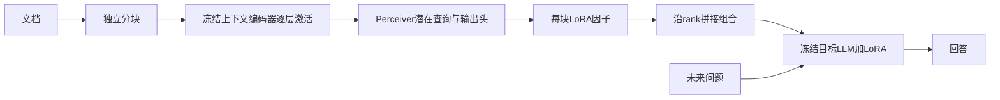

# Doc-to-LoRA调研与SHINE、本项目的比较

核验日期：2026-10-26。本次核对论文、Sakana AI官方代码、公开模型元数据及检查点配置；未下载模型权重、未执行第三方代码、未安装环境或启动GPU。

结论：D2L值得优先作为权重记忆路线的公开推理基线，尤其是已发布的Gemma-2-2B版本。理由是较小的现成基座、明确的证据条件蒸馏、专门的分块组合训练和可读的组合实现；这不是D2L在统一评测上胜过SHINE的结论。它仍缺少完整的长期记忆管理，且不能直接接入当前Qwen3.5-0.8B检查点。

## 1. 论文与出处

**Doc-to-LoRA: Learning to Instantly Internalize Contexts**，Rujikorn Charakorn、Edoardo Cetin、Shinnosuke Uesaka、Robert T. Lange；Sakana AI及Minerva University。arXiv:2602.15902v1，2026-02-13。官方仓库按ICML 2026论文提供引用。

- 论文：`https://arxiv.org/html/2602.15902v1`
- 官方代码：`https://github.com/SakanaAI/doc-to-lora`
- 官方检查点：`https://huggingface.co/SakanaAI/doc-to-lora`

本次模型目录revision为`7514da3cf18439265aef805f2a00170199e44456`。以下论文结果均是作者报告，尚未在5080复现。

## 2. 它怎样把文档变成权重

D2L和SHINE都先训练一个通用参数生成器。遇到新文档时，生成器前向产生LoRA，不针对这篇文档再做SGD训练。之后问题输入可不再包含原文。

Perceiver的可学习潜在查询从各层token激活中提取固定数量的表示，再输出对应LoRA的A/B因子。官方主配置只适配MLP的`down_proj`，rank8。其Gemma-2-2B实验报告约309M个可训练hypernetwork参数，不是只训练一个很小的rank8矩阵。

训练目标是学习模拟上下文蒸馏：

`E_(c,q) KL[p_W(y|c,q) || p_(W+H(c))(y|q)]`

教师是看到文档和问题的冻结底座；学生只看到问题，通过文档生成的LoRA回答。生成器不读取未来问题或答案来写入这一文档，训练时梯度经过学生冻结层传回生成器。

它与当前项目的共同点是冻结底座、可训练写入接口和查询时不回灌原文；区别是内容在LoRA权重里影响内部变换，而不是经Reader读取slots。我们已有`src/dsrsi/model/lora.py`中的MLP down-projection LoRA目标，可提供局部工程参考。但该模块存的是由优化器更新的Parameters，D2L输出的是随文档变化、训练时必须向生成器保留梯度的因子，两者不能视为同一实现。

## 3. 与SHINE相比最值得借鉴的部分

| 项目 | SHINE公开主路线 | D2L公开主路线 |
|---|---|---|
| 文档到参数 | 共享MetaLoRA提取memory states，M2P生成LoRA | 逐层激活经Perceiver产生LoRA |
| 写入器训练 | 重建/补全预训练，再做问答微调 | 证据条件教师分布蒸馏，再做分块组合训练 |
| 生成目标范围 | 官方主实验覆盖多个线性投影 | 官方主配置为MLP down_proj |
| 文档内多块 | 不应直接推断任意adapter可组合 | 明确逐块生成、rank拼接，并训练这种组合 |
| 已核实的公开基座 | 主检查点Qwen3-8B，另有小模型配置 | Gemma-2-2B、Qwen3-4B-Instruct-2507、Mistral-7B |
| 长期记忆系统 | 尚需管理adapter来源、选择、组合与更新 | 同样需要；文档组合不是完整持续记忆管理 |

D2L的启发不只在于换成LoRA，更在于把同一段内容对应的多种问题作为蒸馏任务，并单独学习组合后的行为。不能假设两个单独有效的记忆在一起也自动有效。

论文描述两阶段训练：先学单块，再学习分块组合。当前公开正式检查点配置更具体：stage-II以50%概率使用1块、12.5%使用2块、其余3到8块各6.25%；chunk长度25到512。与只拿单块demo测试多块的做法应区分。

## 4. 源码核验：容量增长与追加语义

`src/ctx_to_lora/modeling/lora_merger.py`将每块A/B沿rank维度拼接。结构对应独立低秩增量的求和，不是分别对A/B求平均。K块的有效内容rank随K线性增长；当前实现分配`(K+1)*r`，并在启用时把共享LoRA bias因子附加一次。`scalers`通过A因子施加，构成相应的加权增量，具体层缩放遵从实现。

所以“分块编码可扩长”不等于“固定大小的参数可无限存储”。保存、装载和未融合adapter计算量都要计入块数及rank。

`hypernet.py`的便捷API也有明确语义：

- `_internalize_from_ids()`生成后执行`self.generated_loras = generated_loras`，替换前一次状态。
- `reset()`清空生成的LoRA并恢复模块原forward。
- 自定义`state_dict()`只保存hypernetwork参数、基座名称与相关配置，没有保存`generated_loras`；官方写入器检查点不等于已写入经历的持久化快照。
- 不能把连续调用`internalize(docA); internalize(docB)`当作已经保留A、B两份记忆。
- 多块批处理和组合在更完整的生成路径中实现；便捷API不构成长期追加、删除、冲突处理和完整恢复的验收。

如果借鉴，我们仍需显式保存每条/每块增量、共享bias身份、来源与时间、活动集合、组合策略和版本；删除应从来源增量重新构造，避免含共享bias的成品adapter被重复叠加。训练生成器时仍需保存完整优化器/RNG/游标/账本，不能只保存生成出的LoRA。

## 5. 速度、显存与离线成本

原论文Table 1在其H200实验设置下报告（作者测量）：

| 更新方式 | update latency | additional update memory |
|---|---:|---:|
| D2L batched | 0.209±0.123秒 | 11.522GB |
| D2L iterative | 0.551±0.101秒 | 3.791GB |

这是内化/更新阶段的指标，不是回答端到端耗时；additional memory不是整个模型总显存。两个模式的速度/显存取舍不能合并成“任意配置在500ms内”，也不能与SHINE的另一平台和任务直接作硬件排名。5080尚未测量。

离线训练同样不便宜：正文及附录报告100K步、8 GPU和每步大规模上下文处理，其中前80K为单块训练，后20K为组合训练。超网络学好后，才把每文档的训练成本换成前向成本。不建议在5080按原规模从头复现，优先用公开权重测能力边界。

官方HF目录包含以下文件，大小来自公开API，不是加载显存：

| 检查点 | 文件大小 | 配置角色 |
|---|---:|---|
| gemma_demo/checkpoint-80000 | 1,261,017,534字节 | 单块demo，num_chunk_probs为空 |
| gemma_2b_d2l/checkpoint-20000 | 1,261,017,534字节 | 从80K单块检查点继续的组合阶段 |
| qwen_4b_d2l/checkpoint-20000 | 1,684,073,598字节 | Qwen3-4B组合阶段 |
| mistral_7b_d2l/checkpoint-20000 | 2,296,925,054字节 | Mistral-7B版本 |

Gemma正式配置为BF16、rank8、target down_proj、量化上下文编码器、`shared_weights: false`。因此除了目标LLM和hypernetwork，还要考虑编码器及激活的占用。2B比8B是更适合首个5080推理对照的工程选择，但峰值总显存必须实测。

Gemma基座`google/gemma-2-2b-it`的公开API标记`gated: manual`，官方D2L超网络仓库本身不gated；真正运行需要已有的基座访问资格。当前未读取或修改任何凭据。

原仓库安装脚本固定torch2.6/CUDA12.4、Transformers4.51.3及特定FlashAttention轮子，与已验证的5080 torch2.10/cu130环境不同。后续应建立E盘独立环境做兼容性验证，不能覆盖正式训练环境，也不直接执行会创建本地venv、下载全部检查点和数据的整套安装脚本。

## 6. 原论文没有替我们证明什么

- 长NIAH实验取的是特殊四位数字，问题形式受控。超过原始窗口仍能找出数字很有价值，但不能排除专用抽取规则，不替代同一记忆下问不同实体/属性/时点的验收。
- 有组合训练与长文QA结果，也不能推断任意两条事实或跨记录推理均正确。块数、有效rank、压缩损失和基座上界需控制。
- 论文C.4明确讨论无关文档内化的知识干扰。仍需保留我们原native保持阈值和关闭/替换记忆对照，不能因更新速度快就声称保持通过。
- Gemma-2B、SHINE的Qwen3-8B与我们Qwen3.5-0.8B不是相同基座；直接比较最终分数不能把差异归因于记忆载体。

## 7. 两条后续研究

**Doc-to-Atom: Learning to Compile and Compose Memory Atoms**，arXiv:2606.12400v1，2026-06-10预印本。提出语义原子、每原子的micro-LoRA与provenance key，再按问题选取组装。它更接近长期经历的可寻址组织方式，值得作为结构设计参考。但有可选micro-KV和读取原子文本的可选reranker；若借鉴纯权重记忆，应分别关掉这些通道做消融，不能将混合系统分数直接算作参数独立保存信息。因子级加权组合还会产生交叉项，不等同于独立增量的精确求和，必须按论文训练设定验证。未复现，不作为当前已有可用模块。

**The Override Gap: A Magnitude Account of Knowledge Conflict Failure in Hypernetwork-Based Instant LLM Adaptation**，arXiv:2604.23750，2026-04预印本及后续修订。提出在其知识冲突设置下，adapter强度相对底座先验不足可能导致覆盖失败，并研究无训练的幅度干预。可用来设计逐层增量/残差幅度诊断；不能把该解释当作我们的双候选故障已被定位，也不能跳过语言保持而直接增大LoRA系数。

## 8. 推荐的近期试验顺序（未执行）

1. 选正式Gemma-2B组合检查点做已发布模型的能力基线，同时保留单块demo作阶段对照。先短输入、单问题验证一致性，再测5080内化延迟及总峰值显存。
2. 固定同一记忆池进行实体A/B、同实体不同属性、旧/新值、改写及无证据问题，比较原文教师、D2L、无adapter。位置、时间、负样本平衡，使用独立测试世界，防止固定位置复制。
3. 分别测一块多事实、多个独立块组合、逐步增加无关块。固定问题与证据时检查错误率、语言保持和rank/内存增长，而不只测特殊数字回忆。
4. 若现成基线有效，再设计Qwen3.5-0.8B的逐层激活→FFN down_proj增量方案。先在副本验证完整恢复，再另立有界run；不能把其他基座hypernetwork直接加载到0.8B，不能改旧run的执行身份或清掉历史消费。
5. 最终长期系统应有可检索的记录/原子、按问题激活和明确更新/删除语义，而不是让所有历史adapter对所有问题永久生效。D2L用于学习写入，Doc2Atom式组织提供设计参考，两者结合仍需项目自己的证据。

本次仅完成调研和设计。当前正式训练态、优化器、累计梯度、来源链与预算均未修改。

## 综合到项目目标

后续候选结构及验证顺序见[项目化综合提案](20261026-project-memory-shape-from-shine-d2l.md)。内容载体、持续工作状态和长期记忆管理需分别验收；该提案不是已实现的新正式架构。
