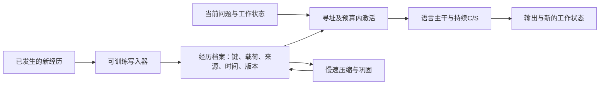

# 回到项目目标：SHINE与Doc-to-LoRA的项目化启发

日期：2026-10-26。状态：候选结构与验证顺序，尚未采纳为正式架构，未实现或启动新训练。本文基于项目原设计和两篇论文进行综合，不代表原论文验证了下述完整系统。

## 1. 能力目标保持不变

依照`docs/memory-design-v0.md`、`docs/qwen35-08b-memory-architecture-v0.md`和`ROADMAP.md`，需要的是具有可恢复生命状态的持续上下文模型：

- 一次新经历改变实例状态；离开窗口、经过干扰后，仍可换问法使用。
- 同一经历可支持事实、原因、关系和任务接续；正确使用取决于当前问题。
- 区分旧值、新值、历史时点、外部观察、模型推断及检索副本。
- 工作内存和活动记忆预算有界；冷档案可以增长，或在固定预算下压缩与遗忘。
- 明文显式记忆和历史工具继续作为独立能力；不能用工具回取原文的成绩替代无工具M-only验收。
- 中断、外部切块和恢复不隐式改变已消费经历、工作状态、活动记忆及后续执行。

因此，slots或LoRA是内容载荷的候选实现。随机完整码测试用于测量精确内容传输，不能代表整个持续经历目标已经完成。

## 2. 两篇论文提供的机制

SHINE（arXiv:2602.06358）提供“读取经历后生成参数增量”的通用写入器范式，以及利用多层表征产生协同LoRA的结构。Doc-to-LoRA（arXiv:2602.15902）提供证据条件教师到无原文学生的分布蒸馏、与下游问题无关的文档编码及显式分块组合训练。具体方法、资源与限制已分别记录在同日的两份专项调研中。

这些机制分别回答如何快速编码、如何训练编码的效用、如何训练组合后的行为。它们没有同时完成本项目的流式生命状态、可寻址档案、更新删除、长期压缩和完整恢复闭环。D2L的rank拼接会随块数增长，也不能当作固定容量的长期压缩器。

## 3. 候选形态：稳定主干与工作状态，可寻址的多种记忆载荷



保持C（近期KV）和S（GDN/conv工作状态）的职责，M继续保存可以分别寻址和管理的经历。记忆记录统一管理key、payload codec、payload、时间范围、来源、更新关系、压缩谱系和版本。payload初期对照slots与LoRA增量，不预设必须同时保存两份。

读时只选预算内的少量记录：slots进入Reader，LoRA候选则组成当前活动增量。设定活动记录数及总rank/参数载荷预算，而不是让所有历史LoRA永久累加。冷档案大小、检索成本和活动显存分别报告。参数载荷仍可被存放于可寻址档案，取回后在模型内部改变计算；这不要求把原文回灌问题。

这是待验证的组织提案。不能直接把多个LoRA因子分别相加当作独立更新的求和，也不能由单块有效推出多块必然有效。应保留可回溯的来源增量，定义共享bias和组合系数的语义，再做预算控制。

## 4. 快速经历写入与慢速学习分开

快速路径由已训练Writer或hypernetwork编码刚发生的经历，不为每条新事实重新运行一次通用微调。新事件写入实例记忆，对源角色、是否外部确认和可见性做标记。

慢速路径包含两个需分别研究的操作：

1. 档案压缩：把若干经历编码成预算内的摘要载荷，保留更新与来源关系，允许可测量的细节损失。
2. 规律巩固：通过受控回放，将反复有用的行为规律学习到共享或实例专属的技能增量中，并重新验证保持和旧记忆兼容性。

两者都是本项目的后续提案，不能把D2L的rank拼接视为已经实现摘要压缩或技能学习。改变共享参数/编码器后要冻结旧codec、迁移或验证兼容性，不能假定旧slots、keys或LoRA自动仍可读。

这样可使具体经历保留可修改、可删除和可追溯的对象，同时让长期行为改进有独立的训练与发布边界。两篇论文支持对通用写入器的探索，不证明一次生成adapter就完成上述慢速巩固。

## 5. 先改变训练单元与验收，再决定载体

关键训练单元建议为“经历集合→一次写入→多种未来问题”，其中学生的记忆集合不随标签变化：

- 相同M里同时有A、B，分别问A与B，答案必须随问题变化。
- 相同实体包含多个属性，分别查询，加入相近实体和无证据问题。
- 同一经历包含尝试、结果与原因，分别问事实、解释、当前任务下一步。
- 旧值与新值并存，当前问题和指定过去时点的问题选择不同证据。
- 对同样问题换真实经历，答案和行动也相应改变。

训练标签可指导损失，但不能让oracle按每个问题偷偷更换候选集合，从而代替问题条件的选择。随机码与按位输出继续作为精确性诊断，同时增加行为与关系任务；避免只把已有控制题变复杂而不先验证底座上界。

采用D2L的监督思想时，教师可见原经历，学生只能用已写入记忆。使用程序真值或教师自由生成正确的筛查，再计算CE、反事实与top32+tail KL；教师不正确时不能把其分布当成必须模仿的真值。普通语言保持单独使用无关记忆条件，门槛不变。

写入器不能读取未来问题/答案。训练中围绕一次写入计算多个未来损失是正常监督，不应变成推理时按预知问题制作专用记忆。同样要计入真实源编码、教师与重复前向成本，不能把多问题共享写入的理想成本当作未经核验的提速。

## 6. 载体对照还应检查写入表征

当前Writer基于H11。SHINE的多层提取和D2L逐层激活提示可做一个独立的小对照：只在源写入路径关闭记忆读取时，比较H11与少量选定层的源表示，再决定是否扩大编码通道。

这只是待验证的瓶颈假设，现有数据不能证明H11不足。多层特征、更多slots和更大的LoRA都会增加容量或参数，实验需分别报告载荷字节、训练参数、输入token、写入延迟和下游效用，不能只凭准确率给载体排名。

## 7. 连续状态下的权重切换是新问题

KV与GDN状态由过去的权重、输入和记忆激活轨迹共同产生。切换活动LoRA后继续使用旧状态，可以被定义为时间变化模型的一种执行语义；它并不等价于从头用新权重重放全部历史。

仅重算近期窗口不能一般性地重建携带更久历史的GDN状态，不能把它当作自动修复办法。可选策略包括在明确边界保留动态轨迹、显式重置/迁移状态或建立独立读分支；每种策略都改变训练和评测路径，应分别验证。

近期先在清空C/S的M-only支路比较内容载体。若权重载荷通过，再为正常持续life定义：

```text
active_memory_ids
active_adapter_version
activation_logical_position
memory_bank_revision
composition_policy_version
write_commit_cursor
```

活动集合只在已消费的逻辑事件边界改变，不由调用者外部chunk边界决定。训练、逐token、分块和恢复必须沿相同激活轨迹执行；checkpoint除C/S、优化器/RNG等原有状态，还需保存adapter内容或可靠引用及其指纹、组合身份和未提交写入。

源写入及寻址也应有明确的参考路径，避免当前候选激活造成不可解释的自选择或把记忆重读副本标成新外部事实。正常连续运行允许记忆影响工作状态，但来源、时序和状态转移必须可核对。

## 8. 建议的实验顺序

1. 固定数据先比较“底座看正确原文”“底座看完整干扰池”“当前M-only”。确认问题在底座理解、选择还是引入记忆后的信息损失。
2. 建立同一M多问题、更新、无证据、跨记录组合和普通语言保持套件，正负样本的时间与位置平衡，保留独立测试世界。
3. 用公开Gemma-2B D2L检查点建立外部参考，分清单块demo与正式组合版本。跨基座成绩用于理解方法边界，不能直接归因为载体优劣。
4. 再在Qwen3.5-0.8B副本上，用相同底座来源、样本和明确预算比较slots与小型FFN-LoRA载荷，分别报告新增参数和容量。先测1条、2条，再到4/8条，原run完整保留。
5. 内容与选择证据成立后，再推进动态激活与持续C/S、原子追加/删除、长期干扰和压缩巩固。新增语义不能在旧run普通resume中偷偷启用，也不提前声称M5–M7通过。

推荐决策：先把D2L的多问题行为蒸馏和组合训练思想纳入下一受控实验设计；把LoRA视为需要对照验证的候选载荷。稳定主干、持续工作状态、可寻址档案及完整恢复继续作为系统骨架。

## 依据与状态

- 原目标：`docs/memory-design-v0.md`、`docs/qwen35-08b-memory-architecture-v0.md`、`ROADMAP.md`。
- SHINE：arXiv:2602.06358v1，记忆提取与参数生成架构。
- Doc-to-LoRA：arXiv:2602.15902v1，query-independent context distillation和rank拼接组合。
- 资源与实现边界：同日SHINE、D2L专项调研。

本次只形成综合候选提案；未修改正式模型结构、训练参数、checkpoint或来源链预算，未启动新训练。
